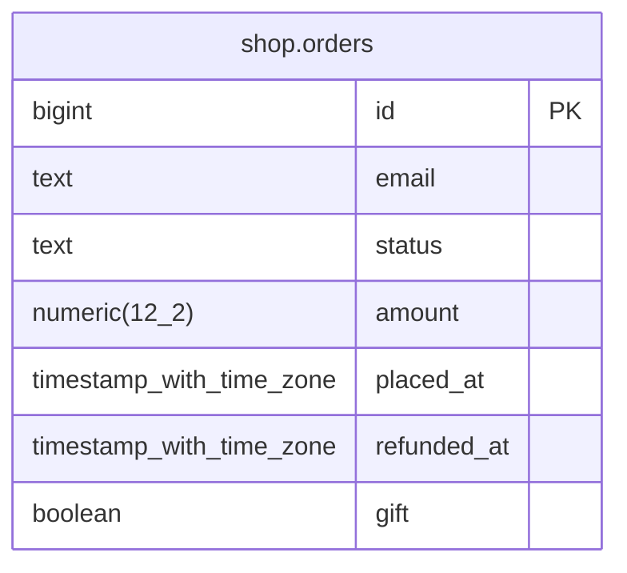

# sql-yodeler-example-postgres: entity relationships

From chant build of the declared schema. Written by `yodel docs`; index.html next to this file has every object's columns, keys, engine and history.

